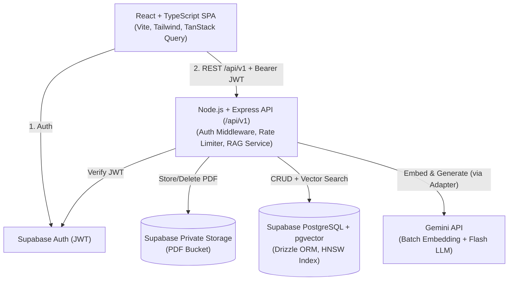
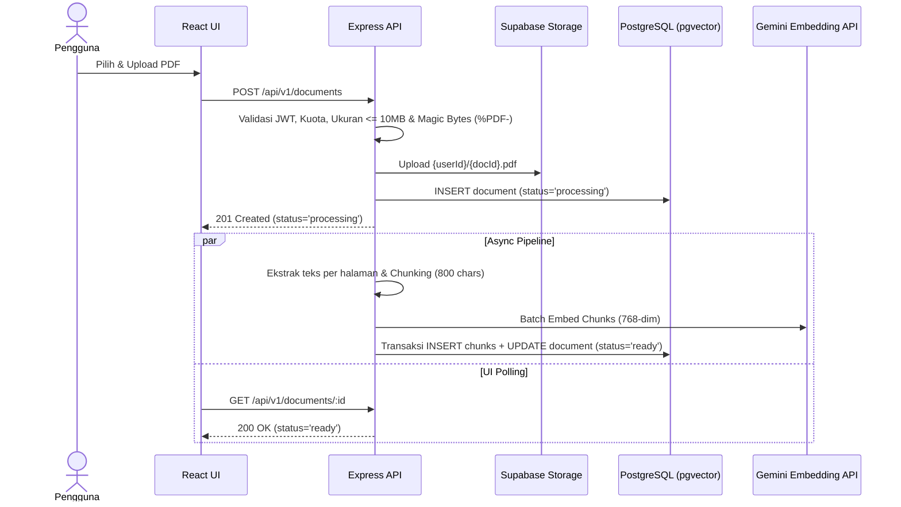
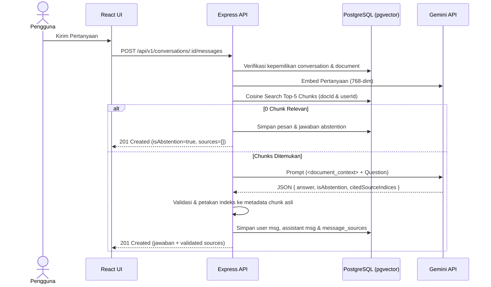

# Product Requirements Document (PRD) — DocuMind AI

## 1. Document Control

| Atribut | Detail |
| :--- | :--- |
| **Nama Dokumen** | Product Requirements Document — DocuMind AI |
| **Nama Produk** | DocuMind AI |
| **Versi Dokumen** | `1.0.0-draft` |
| **Status Dokumen** | Draft |
| **Tanggal Pembuatan** | 21 Oktober 2026 |
| **Pemilik Produk** | Solo Developer / Product Engineer |
| **Horizon Eksekusi** | 21 Hari Kalender |
| **Daftar Reviewer** | Pemilik Proyek (Self-Audit & QA Verification) |

### Riwayat Perubahan (Change Log)

| Versi | Tanggal | Penulis | Deskripsi Perubahan |
| :--- | :--- | :--- | :--- |
| `1.0.0-draft` | 21 Oktober 2026 | Pemilik Produk | Penyusunan perdana PRD lengkap mencakup spesifikasi RAG, model data, API `/api/v1`, pemodelan ancaman keamanan, dan jadwal kerja 21 hari. |

---

## 2. Executive Summary

**DocuMind AI** adalah platform inteligensi dokumen berbasis web yang memungkinkan pengguna terautentikasi mengunggah dokumen PDF berbasis teks, mengajukan pertanyaan dalam bahasa alami mengenai isi dokumen, dan menerima jawaban akurat yang disertai referensi sumber terverifikasi (nama dokumen, nomor halaman, dan potongan teks asli).

Produk ini menggunakan arsitektur **Retrieval-Augmented Generation (RAG)** dengan pelacakan asal-usul halaman (*page-level provenance*) menggunakan PostgreSQL dan `pgvector`. Jawaban dihasilkan semata-mata berdasarkan potongan teks (*chunks*) relevan dari dokumen pengguna, dilengkapi mekanisme penolakan otomatis (*abstention*) ketika bukti di dalam dokumen tidak memadai. Proyek ini dirancang untuk diselesaikan dalam **21 hari kalender** oleh satu developer pada lingkungan kerja berkapasitas RAM 8 GB (Arch Linux + Hyprland) dengan target biaya operasional **$0** melalui pemanfaatan terukur layanan *cloud free tier*.

---

## 3. Product Vision and Principles

1. **Visi Produk:** Menjadi asisten penelaah dokumen yang transparan dan dapat diverifikasi—di mana setiap klaim jawaban AI dapat ditelusuri langsung ke halaman dan kalimat asli di dokumen sumber.
2. **Nilai Utama (Core Value):** Keandalan verifikasi di atas kefasihan bahasa semata (*Verifiability over Fluency*).
3. **Prinsip Pengalaman Pengguna (UX):** Status sistem yang transparan (`uploading`, `processing`, `ready`, `failed`), umpan balik kesalahan yang jelas tanpa mengekspos detail internal, dan kemudahan memeriksa kutipan sumber secara berdampingan (*Side-by-Side Source Inspection*).
4. **Prinsip Keandalan AI:**
   - **Strict Grounding:** Jawaban hanya boleh bersumber dari `<document_context>`.
   - **Deterministic Citation Mapping:** Nomor halaman dan teks kutipan dipetakan oleh kode backend dari database, bukan dikarang bebas oleh LLM.
   - **Explicit Abstention:** Menolak menjawab secara jujur apabila informasi tidak ditemukan di dokumen.
5. **Prinsip Keamanan & Privasi:**
   - **Zero Trust Client Input:** Identitas `user_id` hanya diambil dari JWT terverifikasi, bukan dari payload request klien.
   - **Untrusted Document Content:** Isi PDF diperlakukan sebagai input tidak tepercaya terhadap potensi *indirect prompt injection* dan XSS.
   - **Complete Deletion:** Penghapusan dokumen memusnahkan file di storage, vektor, chunks, dan riwayat percakapan.
6. **Prinsip Minimal Scope & Resource Efficiency:** Mengalihkan beban komputasi berat (database vektor, object storage, pembuatan embedding, dan inferensi LLM) ke cloud terkelola agar konsumsi RAM lokal tetap aman di bawah kapasitas 8 GB.

---

## 4. Problem Statement

- **Masalah yang Dihipotesiskan:** Pembaca dokumen PDF panjang (jurnal ilmiah, laporan teknis, modul kuliah) menghabiskan banyak waktu untuk mencari jawaban spesifik secara manual (`Ctrl+F` gagal menangkap kesamaan semantik). Sebaliknya, penggunaan chatbot AI umum sering mencampuradukkan fakta dokumen dengan pengetahuan bawaan model serta gagal memberikan rujukan nomor halaman yang dapat diverifikasi.
- **Konteks Penggunaan:** Pengguna mengakses aplikasi web dari browser desktop/laptop saat menelaah dokumen PDF berbahasa Indonesia atau Inggris (1–50 halaman).
- **Dampak Masalah yang Diperkirakan:** Rendahnya efisiensi telaah dokumen dan tingginya risiko salah kutip akibat halusinasi AI tanpa rujukan halaman.
- **Bukti yang Tersedia:** Keterbatasan pencarian leksikal `Ctrl+F` dan kecenderungan halusinasi LLM tanpa RAG merupakan batasan teknis yang terdokumentasi secara luas.
- **Hal yang Belum Tervalidasi (Asumsi):** Belum dilakukan riset pasar primer untuk memvalidasi frekuensi unggah dokumen pengguna maupun preferensi antara *single-document chat* vs *multi-document chat*. Untuk MVP 21 hari, produk dikunci pada **satu dokumen per percakapan (*single-document scoped chat*)**.

---

## 5. Goals and Non-Goals

### 5.1 Sasaran Produk (Product Goals)
- Memproses PDF berbasis teks (maksimal 10 MB, maksimal 50 halaman) hingga siap ditanyakan dengan pelestarian nomor halaman 100%.
- Menghasilkan jawaban berbasis konteks dokumen dengan akurasi pemetaan referensi chunk/halaman 100% terhadap sumber yang diambil.
- Menjamin isolasi penuh data antar-pengguna (dokumen, chunks, percakapan, dan pesan).

### 5.2 Sasaran Portofolio (Portfolio Goals)
- Mendemonstrasikan penguasaan React, TypeScript, Node.js, Express, Drizzle ORM, Supabase (`pgvector`), desain REST API `/api/v1`, keamanan aplikasi, pengujian otomatis (Vitest, Supertest, Playwright), dan evaluasi metrik RAG.
- Menyajikan dokumentasi rekayasa yang jujur, terukur, dan bebas dari klaim berlebihan.

### 5.3 Non-Goals (Out of Scope MVP)
- OCR untuk PDF hasil pemindaian gambar (*scanned PDF*).
- Format selain PDF (DOCX, XLSX, PPTX, TXT, gambar).
- Percakapan lintas banyak dokumen sekaligus (*multi-document RAG*).
- Sistem pembayaran, *billing*, atau langganan.
- Kolaborasi tim, berbagi dokumen, atau *Role-Based Access Control* (RBAC) enterprise.
- *Fine-tuning* model, *multi-agent orchestration*, atau *hybrid search* kompleks.
- Penggunaan banyak provider AI aktif sekaligus atau LLM lokal sebagai jalur utama.
- Aplikasi mobile native dan *real-time collaborative chat*.

---

## 6. Target Users and Personas (Hipotesis Belum Tervalidasi)

> **Catatan:** Persona di bawah ini merupakan **hipotesis desain** untuk memandu skenario penggunaan MVP, bukan hasil riset pengguna primer.

| Atribut | Persona 1: Mahasiswa / Peneliti Akademik | Persona 2: Analis / Profesional Teknis |
| :--- | :--- | :--- |
| **Jobs to Be Done** | Menanyakan metodologi, argumen utama, dan temuan dari paper/materi kuliah PDF beserta halaman kutipannya. | Menemukan aturan, spesifikasi teknis, atau klausul di dalam manual/laporan PDF tanpa membaca seluruh halaman. |
| **Pain Points** | Takut salah mengutip halaman; pencarian kata kunci tidak menemukan sinonim konsep. | Waktu terbatas untuk memeriksa silang klaim ringkasan AI terhadap dokumen asli. |
| **Risiko Asumsi** | Jika dokumen pengguna berupa hasil scan kamera, sistem akan menolak pemrosesan (dimitigasi dengan pesan error `EMPTY_EXTRACTED_TEXT` yang jelas). | Jika dokumen melebihi 50 halaman, sistem menolak untuk melindungi kuota gratis (dimitigasi dengan informasi batas eksplisit di UI upload). |

---

## 7. User Stories and Use Cases

| ID | User Story | Prioritas |
| :--- | :--- | :--- |
| **US-01** | *As a user, I want to register, log in, and log out securely, so that my documents and chats remain private.* | P0 |
| **US-02** | *As an authenticated user, I want to upload a text-based PDF and track its processing status, so that I know when I can start asking questions.* | P0 |
| **US-03** | *As an authenticated user, I want to view my document library with file metadata and delete documents I no longer need, so that I can manage my storage quota.* | P0 |
| **US-04** | *As an authenticated user, I want to ask natural language questions about a specific document, so that I can get answers grounded in its content.* | P0 |
| **US-05** | *As an authenticated user, I want every answer to display clickable source citations with document name, page number, and source snippet, so that I can verify the answer.* | P0 |
| **US-06** | *As an authenticated user, I want the system to clearly state when the document does not contain enough evidence to answer my question, so that I avoid hallucinated answers.* | P0 |
| **US-07** | *As an authenticated user, I want my conversation history and messages saved automatically, so that I can review previous Q&A sessions.* | P0 |
| **US-08** | *As an authenticated user, I want to retry processing a failed document, so that temporary AI provider errors do not force me to re-upload the file.* | P0 |
| **US-09** | *As an authenticated user, I want to delete individual conversations on a document, so that I can keep my workspace organized.* | P1 |

---

## 8. User Journey and Workflows

### 8.1 Alur Normal (Happy Path)
1. Pengguna mendaftar/login → Masuk ke **Document Library (`/dashboard`)**.
2. Pengguna mengunggah PDF berbasis teks (<= 10 MB, <= 50 halaman).
3. Backend memvalidasi *magic bytes* (`%PDF-`), menyimpan file ke Supabase Storage privat, mencatat status `processing` di DB, lalu menjalankan ekstraksi per halaman, chunking, dan pembuatan embedding batch ke `pgvector`.
4. Frontend memperbarui status dokumen menjadi `ready` melalui *polling* berkala.
5. Pengguna membuka dokumen (`/documents/:id`), membuat/memilih sesi percakapan, dan mengirim pertanyaan.
6. Backend memverifikasi kepemilikan dokumen, membuat embedding pertanyaan, mengambil *top-5 chunks* relevan milik dokumen tersebut, dan memanggil LLM dengan skema output terstruktur.
7. Backend memvalidasi indeks sitasi terhadap chunks yang diambil, menyimpan pesan beserta `message_sources`, dan mengembalikan jawaban ke UI.
8. Pengguna mengeklik lencana sitasi `[1 - Hal. X]` untuk membuka **Source Inspector** dan membaca potongan teks asli dari halaman tersebut.

### 8.2 Alur Kegagalan (Failure Workflows)
- **PDF Invalid / MIME Spoofing:** Ditolak di tahap upload dengan HTTP `400` (`INVALID_FILE_TYPE`) atau `413` (`FILE_TOO_LARGE`).
- **PDF Tanpa Teks (Scan) / Terenkripsi / > 50 Halaman:** Status dokumen diubah menjadi `failed` dengan kode spesifik (`EMPTY_EXTRACTED_TEXT`, `ENCRYPTED_PDF`, `PAGE_LIMIT_EXCEEDED`) dan alasan ditampilkan di kartu dokumen.
- **Pemrosesan / Embedding Gagal:** Setelah 3x *exponential backoff retry* gagal, transaksi penyimpanan chunks di-*rollback* bersih dan status menjadi `failed` (`EMBEDDING_PROVIDER_ERROR`). Pengguna dapat menekan tombol **Retry**.
- **Provider AI Tidak Tersedia saat Chat:** Mengembalikan HTTP `503` (`AI_PROVIDER_UNAVAILABLE`) atau `429` (`RATE_LIMIT_EXCEEDED`); UI menampilkan opsi kirim ulang tanpa menghapus draf pertanyaan pengguna.
- **Retrieval Tidak Menemukan Konteks Relevan:** Sistem mengembalikan jawaban *abstention* (`is_abstention: true`, `sources: []`) yang menyatakan bukti tidak ditemukan di dokumen.
- **Sesi Berakhir / Dokumen Dihapus:** Merespons dengan HTTP `401` (arahkan ke `/login`) atau `404` (arahkan kembali ke `/dashboard`).

---

## 9. Functional Requirements

| ID | Nama Requirement | Prioritas | Preconditions | Expected Behavior | Acceptance Criteria (Teruji) | Verifikasi |
| :--- | :--- | :--- | :--- | :--- | :--- | :--- |
| **FR-AUTH-001** | Registrasi & Login Akun | P0 | Pengguna belum login | Autentikasi email/password via Supabase Auth menerbitkan JWT valid. | 1. Login kredensial valid mengembalikan sesi aktif. 2. `GET /api/v1/auth/me` dengan JWT valid mengembalikan `200 OK`. | Supertest & Playwright |
| **FR-AUTH-002** | Sesi Kedaluwarsa & Logout | P0 | Pengguna mengakses endpoint privat | Menolak token tidak valid/kedaluwarsa dan menghapus sesi saat logout. | 1. Request tanpa token/token kedaluwarsa ke `/api/v1/*` ditolak `401`. 2. Logout mengalihkan UI ke `/login`. | Supertest & Playwright |
| **FR-DOC-001** | Upload & Validasi PDF | P0 | Pengguna login; kuota < 10 dokumen | Memvalidasi ukuran <= 10 MB dan *magic bytes* `%PDF-`, menyimpan ke Storage privat, dan membuat baris `documents`. | 1. PDF valid <= 10 MB merespons `201 Created`. 2. File non-PDF berlabel `.pdf` ditolak `400`. 3. File > 10 MB ditolak `413`. | Vitest & Supertest |
| **FR-DOC-002** | Daftar & Status Dokumen | P0 | Pengguna login | Mengembalikan daftar dokumen milik pengguna beserta status (`uploading`, `processing`, `ready`, `failed`). | 1. `GET /api/v1/documents` hanya memuat dokumen milik `user_id` aktif. 2. Menampilkan *empty state* jika kosong. | Supertest & Playwright |
| **FR-DOC-003** | Penghapusan Dokumen Menyeluruh | P0 | Pengguna adalah pemilik dokumen | Menghapus file di Supabase Storage dan baris di DB beserta seluruh tabel turunan (`CASCADE`). | 1. `DELETE /api/v1/documents/:id` merespons `200`. 2. Baris di `documents`, `document_chunks`, `conversations`, `messages`, `message_sources` menjadi 0. | Supertest & DB Test |
| **FR-PROC-001** | Ekstraksi Teks per Halaman | P0 | Dokumen berstatus `processing` | Mengekstrak teks halaman demi halaman (`1..N`) dan memvalidasi jumlah halaman <= 50. | 1. Menyimpan `page_count` akurat. 2. PDF > 50 halaman atau teks < 50 karakter diubah ke `failed` dengan kode error eksplisit. | Vitest |
| **FR-PROC-002** | Page-Aware Chunking | P0 | Teks halaman berhasil diekstrak | Memotong teks (target 800 karakter, overlap 150) dengan mempertahankan `page_number` dan `chunk_index`. | 1. Seluruh chunks memiliki `page_number >= 1` dan `chunk_index` berurutan. 2. Tidak ada chunk melebihi batas keras 1.000 karakter. | Vitest |
| **FR-PROC-003** | Batch Embedding & `pgvector` Storage | P0 | Chunks terbentuk | Menghasilkan vektor 768 dimensi secara batch dan menyimpan secara atomik ke `document_chunks`. | 1. Dokumen `ready` memiliki vektor 768-dim pada seluruh chunks. 2. Kegagalan embedding melakukan *rollback* (0 partial chunks). | Vitest & DB Integration |
| **FR-PROC-004** | Retry Pemrosesan Dokumen | P0 | Dokumen berstatus `failed` | Membersihkan sisa state gagal dan memicu ulang pipeline ekstraksi/embedding. | 1. `POST /api/v1/documents/:id/retry` pada dokumen `failed` merespons `202 Accepted`. 2. Ditolak `400` jika dokumen sudah `ready`. | Supertest |
| **FR-RAG-001** | Scoped Similarity Retrieval | P0 | Dokumen `ready` & milik pengguna | Mengambil maksimal Top-5 chunks (`similarity >= 0.55`) khusus dari `document_id` dan `user_id` terkait. | 1. Query tidak pernah mengembalikan chunk milik dokumen atau pengguna lain. 2. Hasil terurut dari kemiripan tertinggi. | DB Integration Test |
| **FR-RAG-002** | Grounded Generation & Abstention | P0 | Hasil retrieval tersedia | Menghasilkan jawaban terikat konteks atau menyatakan bukti tidak cukup (`is_abstention: true`). | 1. Jika 0 chunk melewati threshold, langsung mengembalikan `isAbstention: true` dan `sources: []`. 2. Jawaban *in-scope* merujuk fakta di chunk. | Vitest & RAG Eval Script |
| **FR-RAG-003** | Riwayat Percakapan & Pesan | P0 | Pengguna memiliki akses dokumen | Menyimpan sesi percakapan dan urutan pesan `user` serta `assistant`. | 1. `GET /api/v1/conversations/:id/messages` mengembalikan urutan pesan kronologis beserta array `sources`. | Supertest & Playwright |
| **FR-CIT-001** | Deterministic Citation Mapping | P0 | Jawaban asisten bukan abstention | Memvalidasi indeks sitasi LLM (`[1..K]`) dan memetakannya ke `chunk_id`, `page_number`, dan `snippet` asli di DB. | 1. Indeks sitasi di luar rentang `[1..K]` dibuang oleh backend. 2. Klik sitasi di UI menampilkan halaman & teks chunk asli. | Vitest & Playwright |
| **FR-SEC-001** | Isolasi Data Lintas Pengguna | P0 | Minimal 2 akun pengguna berbeda | Menolak seluruh akses baca/tulis/hapus lintas pengguna pada dokumen dan percakapan. | 1. User B yang mengakses endpoint dengan UUID milik User A selalu menerima HTTP `404 Not Found`. | Supertest Security Suite |
| **FR-SEC-002** | Prompt Injection & XSS Guard | P0 | Dokumen/pesan berisi karakter khusus | Meng-escape delimiter `<document_context>` dan me-render teks sumber tanpa eksekusi HTML/JS mentah. | 1. Payload `<script>` di dalam PDF tampil sebagai teks biasa tanpa dieksekusi browser. | Vitest & Component Test |
| **FR-OPS-001** | Operational Feedback & Rate Limit | P0 | Pengguna mengirim request ke API | Menampilkan state UI lengkap dan membatasi chat (15 req/menit) serta upload (5 req/10 menit). | 1. Request ke-16/menit pada chat ditolak HTTP `429`. 2. Respons error sesuai format JSON standar tanpa *stack trace*. | Supertest |
| **FR-OPS-002** | Observabilitas & Health Check | P0 | Server backend berjalan | Menyediakan `/api/v1/health` dan mencatat log terstruktur tanpa membocorkan kredensial. | 1. `GET /api/v1/health` merespons `200 OK`. 2. Log menyensor header `Authorization` dan API keys. | Vitest & Supertest |
| **FR-OPS-003** | Hapus Sesi Percakapan | P1 | Pengguna pemilik percakapan | Menghapus satu sesi percakapan beserta pesan di dalamnya tanpa menghapus dokumen. | 1. `DELETE /api/v1/conversations/:id` merespons `200 OK` dan menghapus pesan terkait. | Supertest |

---

## 10. Non-Functional Requirements (Target Sementara untuk Divalidasi)

- **Security (`NFR-SEC-01`):** 100% endpoint privat memverifikasi JWT; 0 kunci rahasia backend di dalam bundle frontend (`dist/`).
- **Privacy (`NFR-PRV-01`):** Isi dokumen dan pertanyaan tidak dicatat pada log produksi default; penghapusan bersifat menyeluruh.
- **Performance (`NFR-PRF-01`):** Target sementara: endpoint metadata `<= 500 ms` (p95 warm), pemrosesan PDF 10 halaman `<= 15 detik`, dan tanya-jawab RAG `<= 8 detik` (p95).
- **Reliability (`NFR-REL-01`):** Transaksi database bersifat atomik saat menyimpan `document_chunks` (0 *partial chunks* saat gagal).
- **Availability (`NFR-AVL-01`):** Endpoint `GET /api/v1/health` aktif untuk pemeriksaan kesiapan dan pemanasan (*warm-up*) container free tier.
- **Maintainability (`NFR-MNT-01`):** Lulus `tsc --noEmit` (`strict: true`) dan memisahkan provider AI melalui *adapter interface*.
- **Accessibility & Usability (`NFR-ACC-01`, `NFR-USB-01`):** Navigasi keyboard berfungsi pada kontrol utama; seluruh aksi asinkron memiliki indikator status visual.
- **Compatibility (`NFR-CMP-01`):** Berjalan pada Chromium dan Firefox terbaru (desktop `>= 1280x720` dan responsif mobile `>= 375px`).
- **Resource Consumption (`NFR-RES-01`):** Penggunaan memori gabungan proses pengembangan lokal di bawah `1,2 GB RAM` (aman untuk laptop 8 GB); heap backend saat memproses PDF 10 MB di bawah `350 MB` (aman untuk container cloud 512 MB).

---

## 11. AI and RAG Requirements

1. **Pemisahan Konsep Kualitas:** Sistem membedakan secara tegas antara *Source Traceability* (validitas pemetaan ID chunk & halaman), *Retrieval Relevance* (ketepatan pengambilan chunk oleh `pgvector`), dan *Answer Faithfulness* (kesetiaan kesimpulan LLM terhadap chunk).
2. **Page-Level Extraction:** Menggunakan `pdfjs-dist` (legacy build) untuk mengekstrak teks per halaman (`1..N`) dan menormalkan karakter null `\u0000`.
3. **Chunking Strategy:** Pemotongan rekursif per halaman dengan target `800 karakter`, overlap `150 karakter`, dan *cross-page context bridge* hingga `100 karakter`.
4. **Embedding Model:** Menggunakan model embedding Gemini API dengan dimensi output dikunci pada **768 dimensi** (`vector(768)`) dan pengiriman *batch* (maksimal 20 chunks per request).
5. **Retrieval & Scoring:** Pencarian kemiripan kosinus (`1 - (embedding <=> query_vector)`) dengan filter wajib `document_id` dan `user_id`, mengambil maksimal `TOP_K = 5` chunks dengan `SIMILARITY_THRESHOLD >= 0.55` (dikalibrasi saat evaluasi).
6. **Prompt Construction & Grounding:** Menggunakan pemisahan instruksi sistem dan blok data `<document_context><source index="1" page="X">...</source></document_context>`, `temperature = 0.1`, serta skema output JSON `{ answer, isAbstention, citedSourceIndices }`.
7. **Abstention & Citation Mapping:** Jika 0 chunk melewati ambang batas, backend langsung mengembalikan respons *abstention* tanpa memanggil LLM. Jika LLM menjawab, backend memetakan `citedSourceIndices` langsung ke record chunk asli di memori/DB.

---

## 12. Information Architecture and UX Requirements

1. **Login / Register (`/login`, `/register`):** Form autentikasi dengan state *idle*, *submitting*, dan *error alert*.
2. **Document Library (`/dashboard`):** Header informasi kuota (`X / 10 Dokumen`), komponen Dropzone upload PDF (menampilkan batas 10 MB / 50 halaman), serta daftar kartu dokumen dengan badge status (`Mengunggah`, `Memproses`, `Siap`, `Gagal`), tombol **Buka Chat**, **Coba Lagi (Retry)**, dan **Hapus**.
3. **Document Workspace (`/documents/:id`):**
   - **Panel Kiri:** Daftar riwayat percakapan pada dokumen tersebut dan tombol **+ Percakapan Baru**.
   - **Panel Tengah (Chat):** Aliran pesan tanya-jawab, penanda visual untuk jawaban *abstention*, deretan lencana sitasi `[1 - Hal. X]`, dan input pertanyaan (maksimal 1.000 karakter).
   - **Panel Kanan / Drawer (Source Inspector):** Menampilkan judul dokumen, nomor halaman, skor kemiripan, dan teks asli chunk saat lencana sitasi diklik.

---

## 13. Data Model Requirements

Menggunakan Supabase PostgreSQL dengan ekstensi `vector` (`pgvector`) dan merujuk langsung ke `auth.users(id)`:
- **`documents`:** `id (PK, UUID)`, `user_id (FK -> auth.users ON DELETE CASCADE)`, `title`, `original_filename`, `storage_path (UNIQUE)`, `mime_type`, `file_size_bytes`, `page_count`, `status ('uploading'|'processing'|'ready'|'failed')`, `error_code`, `error_message`, `created_at`, `updated_at`.
- **`document_chunks`:** `id (PK, UUID)`, `document_id (FK -> documents ON DELETE CASCADE)`, `user_id (FK)`, `chunk_index`, `page_number`, `content`, `token_estimate`, `embedding vector(768)`, `created_at`. Indeks: `UNIQUE(document_id, chunk_index)` dan indeks `HNSW (embedding vector_cosine_ops)`.
- **`conversations`:** `id (PK, UUID)`, `document_id (FK -> documents ON DELETE CASCADE)`, `user_id (FK)`, `title`, `created_at`, `updated_at`.
- **`messages`:** `id (PK, UUID)`, `conversation_id (FK -> conversations ON DELETE CASCADE)`, `user_id (FK)`, `role ('user'|'assistant')`, `content`, `is_abstention`, `created_at`.
- **`message_sources`:** `id (PK, UUID)`, `message_id (FK -> messages ON DELETE CASCADE)`, `chunk_id (FK -> document_chunks ON DELETE CASCADE)`, `citation_order`, `page_number`, `similarity_score`, `created_at`.

---

## 14. API Requirements (`/api/v1`)

| Method & Path | Auth | Deskripsi & Validasi Utama | Status Codes |
| :--- | :--- | :--- | :--- |
| `GET /api/v1/health` | Publik | Pemeriksaan kesehatan layanan & koneksi DB. | `200`, `503` |
| `GET /api/v1/auth/me` | Bearer JWT | Profil sesi pengguna aktif & pemakaian kuota dokumen. | `200`, `401` |
| `GET /api/v1/documents` | Bearer JWT | Daftar dokumen milik pengguna yang login. | `200`, `401` |
| `POST /api/v1/documents` | Bearer JWT | Upload PDF (`multipart/form-data`, <= 10 MB, `%PDF-`). Rate limit: 5/10m. | `201`, `400`, `401`, `413`, `429` |
| `GET /api/v1/documents/:id` | Bearer JWT | Detail metadata & status satu dokumen milik pengguna. | `200`, `401`, `404` |
| `POST /api/v1/documents/:id/retry` | Bearer JWT | Memicu ulang pemrosesan dokumen berstatus `failed`. | `202`, `400`, `401`, `404`, `429` |
| `DELETE /api/v1/documents/:id` | Bearer JWT | Menghapus objek Storage dan record DB (`CASCADE`). | `200`, `401`, `404` |
| `POST /api/v1/conversations` | Bearer JWT | Membuat sesi percakapan baru pada dokumen berstatus `ready`. | `201`, `400`, `401`, `404` |
| `GET /api/v1/conversations` | Bearer JWT | Daftar sesi percakapan milik pengguna (filter opsional `?documentId=`). | `200`, `401` |
| `GET /api/v1/conversations/:id/messages` | Bearer JWT | Mengambil seluruh pesan beserta daftar `sources` sitasi. | `200`, `401`, `404` |
| `POST /api/v1/conversations/:id/messages` | Bearer JWT | Mengirim pertanyaan (2–1.000 karakter) dan menerima jawaban RAG bersitasi. Rate limit: 15/m. | `201`, `400`, `401`, `404`, `429`, `503` |

---

## 15. Security, Privacy, and Threat Model

- **IDOR / Broken Access Control:** Seluruh query wajib menyertakan `WHERE user_id = authenticatedUser.id` ditambah kebijakan Supabase RLS.
- **Cross-User Vector Search:** Fungsi retrieval mewajibkan parameter `documentId` dan `userId` yang telah diverifikasi.
- **File Upload & MIME Spoofing:** Validasi ukuran <= 10 MB, *magic bytes* `%PDF-`, dan penamaan objek Storage berbasis UUID.
- **Indirect Prompt Injection:** Isolasi konteks di dalam tag `<document_context>`, escaping tag penutup, dan pemetaan sitasi deterministik di luar kendali teks bebas LLM.
- **XSS Prevention:** Menampilkan potongan teks sumber sebagai teks biasa (di-escape React) dan menonaktifkan raw HTML pada renderer Markdown.

---

## 16. Success Metrics and Evaluation (Target Awal MVP)

- **Security Isolation:** 100% skenario akses lintas pengguna pada test suite ditolak (`404`/`401`).
- **Citation Traceability:** 100% sitasi menunjuk ke `chunk_id` dan `page_number` yang valid di database.
- **Retrieval Quality:** Target awal *Recall@5* `>= 80%` pada dataset evaluasi internal (30–50 pertanyaan).
- **Abstention Accuracy:** Target awal `>= 90%` pertanyaan *out-of-scope* menghasilkan `is_abstention: true`.

---

## 17. Test Strategy and Acceptance Plan

- **Unit Tests (Vitest):** Validator PDF, ekstraktor halaman, chunker, konstruktor prompt, citation mapper, dan redaksi log.
- **API & Security Integration Tests (Supertest):** Kontrak `/api/v1/*`, skenario lintas pengguna (User A vs User B), siklus retry/delete, dan rate limiting menggunakan *Mock AI Adapter*.
- **End-to-End Tests (Playwright):** Alur penuh dari Login → Upload PDF → Ready → Tanya-Jawab → Klik Sitasi → Hapus Dokumen (dijalankan dengan `workers: 1` untuk menghemat RAM).

---

## 18. Technical Architecture Overview

### 18.1 High-Level System Architecture

### 18.2 Upload & Processing Workflow

### 18.3 RAG Question-Answer Workflow

---

## 19. Scope and Prioritization

Lihat rincian lengkap pada berkas [`docs/mvp-scope.md`](./docs/mvp-scope.md). Seluruh fitur P0 (F-01 s/d F-08) wajib tuntas sebelum fitur P1 (F-09) disentuh.

---

## 20. 21-Day Delivery Plan

- **Minggu 1 (Hari 1–7):** Inisialisasi repo & verifikasi kuota cloud (H1), skema & migrasi Drizzle `pgvector` (H2), autentikasi JWT Supabase (H3–H4), upload PDF & Storage (H5), ekstraksi PDF per halaman & chunker (H6), serta buffer integrasi & unit test Minggu 1 (H7).
- **Minggu 2 (Hari 8–14):** Adapter AI & batch embedding (H8), mekanisme error & retry dokumen (H9), repository retrieval `pgvector` (H10), konstruksi prompt RAG & abstention (H11), deterministic citation mapper & endpoint chat (H12), UI Document Workspace & Source Inspector (H13), serta buffer integrasi & kalibrasi threshold Minggu 2 (H14).
- **Minggu 3 (Hari 15–21):** Security hardening & rate limiting (H15), suite pengujian isolasi lintas pengguna Supertest (H16), evaluasi kualitas RAG 30–50 pertanyaan (H17), pengujian E2E Playwright (H18), deployment cloud free tier (H19), dokumentasi lengkap & audit rahasia (H20), serta final smoke test & rilis MVP (H21).

---

## 21. Risks, Assumptions, and Dependencies

Lihat rincian matriks risiko pada berkas [`docs/risk-register.md`](./docs/risk-register.md). Ketergantungan utama mencakup kuota RPM/RPD Gemini API Free Tier, batas 500 MB DB / 1 GB Storage dan kebijakan *auto-pause* 7 hari pada Supabase Free Tier, serta batas RAM 8 GB pada mesin lokal.

---

## 22. Open Questions and Decisions Log

Lihat rincian rekaman keputusan pada berkas [`docs/decision-log.md`](./docs/decision-log.md). Sebelum menulis kode pada Hari ke-1, developer wajib memverifikasi nama model embedding dan Flash aktif pada Google AI Studio serta memilih apakah konfirmasi email Supabase Auth dinonaktifkan selama mode demo portofolio.

---

## 23. Definition of Done (DoD)

1. Seluruh fitur P0 berfungsi penuh tanpa stub.
2. Pengujian otomatis isolasi lintas pengguna lulus 100%.
3. PDF berbasis teks berhasil diproses hingga `ready` dan PDF kosong/scan ditolak secara informatif.
4. Jawaban chat terhubung ke chunk dan halaman yang benar melalui *Source Inspector*.
5. Skenario kegagalan utama dan retry tertangani dengan aman.
6. Test suite (Vitest, Supertest, Playwright) dan laporan evaluasi RAG tersedia di repo.
7. Aplikasi ter-deploy atau memiliki prosedur demo lokal yang teruji bersih.
8. `README.md` dan folder `docs/` lengkap serta sinkron.
9. 0 kredensial/secret bocor di kode, riwayat Git, bundle frontend, maupun log.
10. Limitasi MVP terdokumentasi secara transparan.

---

## 24. Appendix

- **Traceability Matrix:** [`docs/requirements-traceability.md`](./docs/requirements-traceability.md)
- **Decision Log:** [`docs/decision-log.md`](./docs/decision-log.md)
- **MVP Scope:** [`docs/mvp-scope.md`](./docs/mvp-scope.md)
- **Risk Register:** [`docs/risk-register.md`](./docs/risk-register.md)
- **Evaluation Plan:** [`docs/evaluation-plan.md`](./docs/evaluation-plan.md)